<p align="center">
  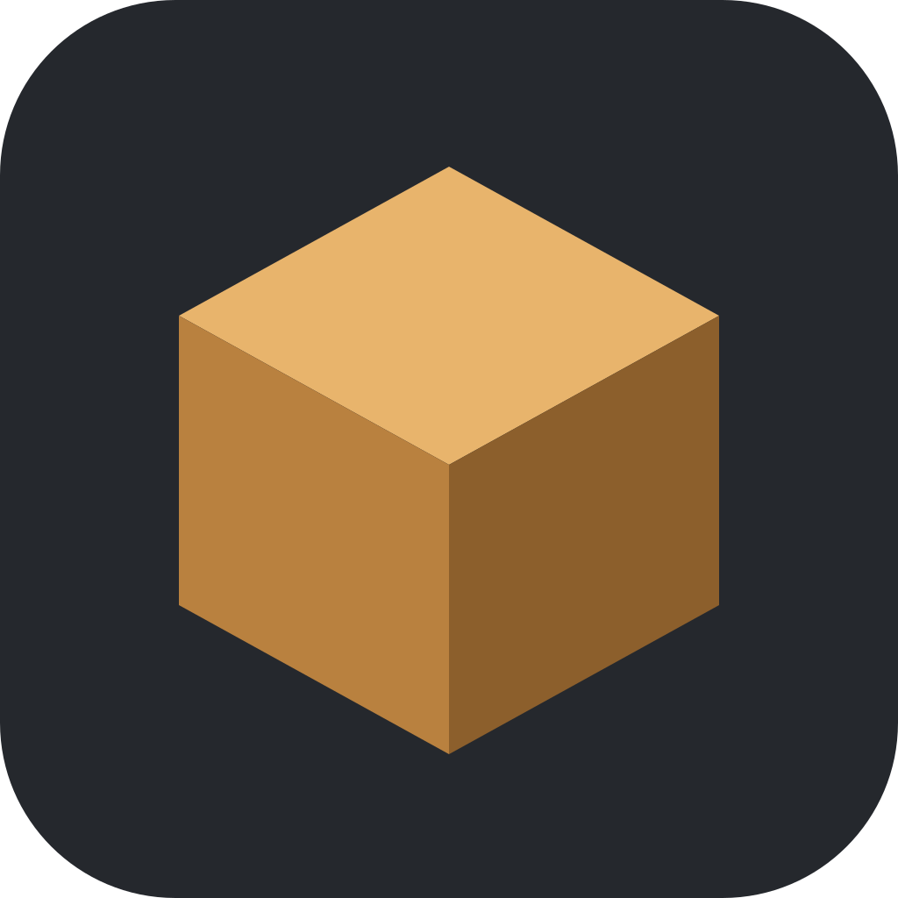
</p>

<h1 align="center">Asset Studio 3D</h1>

<p align="center">
  Ferramenta desktop para organizar os modelos 3D de um jogo, montar os mapas e entregar tudo pronto para o Godot.
</p>

<p align="center">
  
  
  
  
  
  
</p>

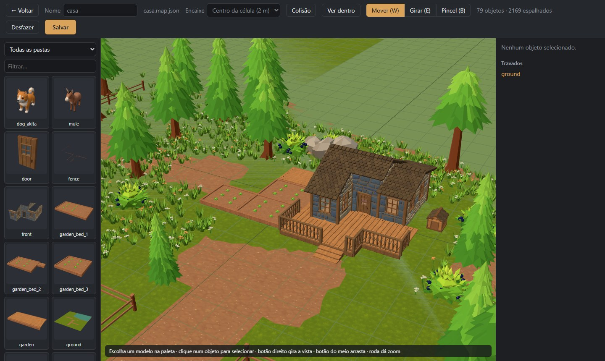

O Asset Studio 3D nasceu para o **Alvorland**, um jogo de fazenda em low poly feito no Godot. Ele substitui o trabalho
manual de copiar `.glb`, montar cenas à mão e conferir escala modelo por modelo. Os modelos e os mapas ficam numa
**pasta de origem**, e a ferramenta deixa o projeto Godot igual a ela com um clique.

## Destaques

- **Catálogo de modelos** com miniaturas geradas na própria ferramenta, separado por pasta e com filtro por nome.
- **Visualizador 3D** que mostra tamanho em metros e em células da grade, triângulos, materiais, malha em aramado e
  toca as animações do modelo.
- **Editor de mapa** completo: colocar, mover, girar, subir e descer peças com gizmos, encaixe na grade, desfazer,
  duplicar, travar e esconder.
- **Pincel de vegetação**: espalha milhares de cópias (grama, flores, pedrinhas) desenhadas com `InstancedMesh`
  e exportadas para o Godot como `MultiMesh`.
- **Ver dentro** e **Colisão**: espia o interior das casas como o jogo faz e destaca as malhas que serão sólidas.
- **Sincronização com o Godot** com prévia: mostra o que vai ser copiado, apagado e gerado antes de mudar qualquer
  arquivo, e roda a importação do Godot no fim.

## Telas

### Catálogo de modelos

Todos os `.glb`/`.gltf` da pasta `assets`, agrupados por pasta. As miniaturas usam a mesma inclinação da câmera do jogo
(30° de elevação, 30° de giro) e ficam em cache, sendo refeitas só quando o arquivo muda.

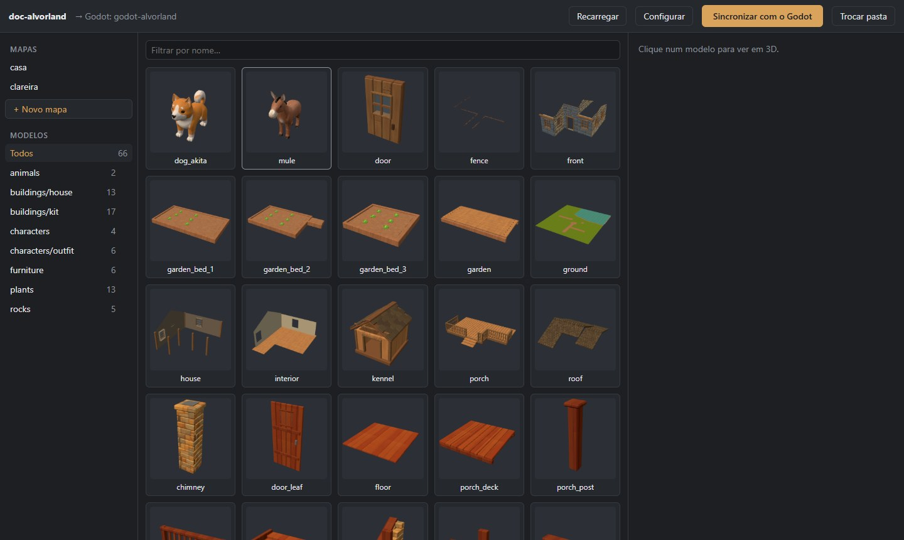

### Visualizador

Clique num modelo para vê-lo em 3D numa grade de células de 2 m. O painel avisa quando a base não está no chão, lista
materiais e animações e liga o aramado para conferir a malha.

| Informações do modelo | Malha em aramado |
| --- | --- |
| 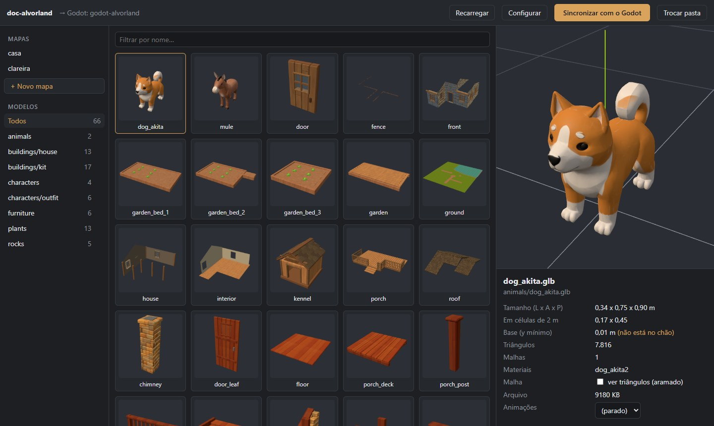 | 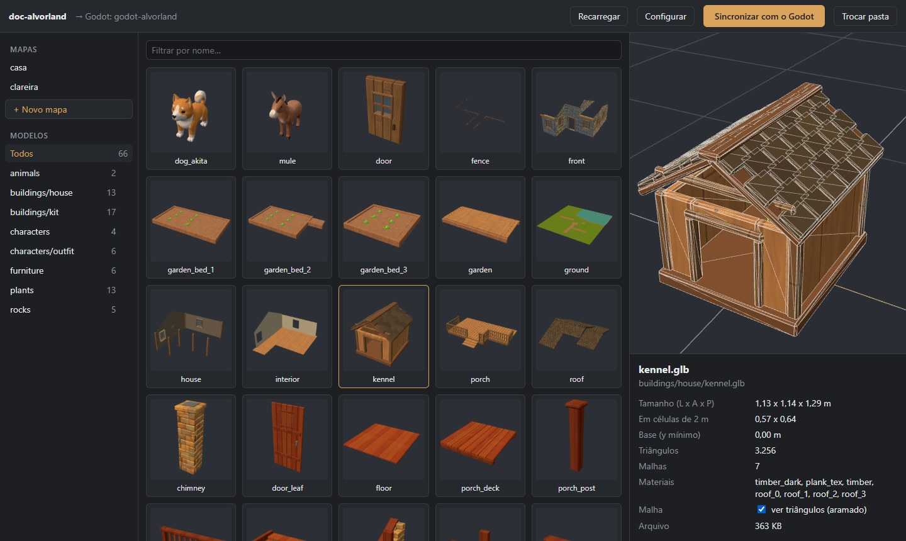 |

### Editor de mapa

A paleta à esquerda tem todos os modelos. Clique num deles e depois no chão para colocar. O objeto selecionado ganha
setas para arrastar (a verde sobe e desce) ou um anel para girar, e o painel à direita aceita valores exatos de
posição, giro e escala.

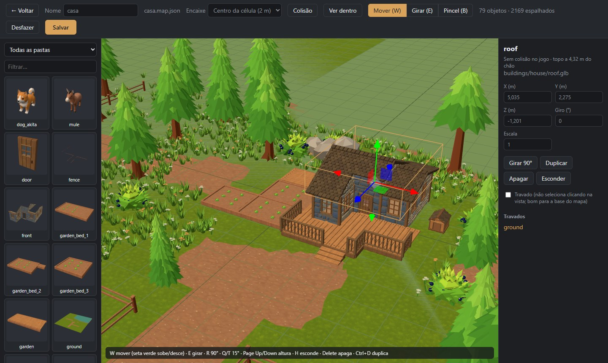

| Ver dentro | Colisão |
| --- | --- |
| 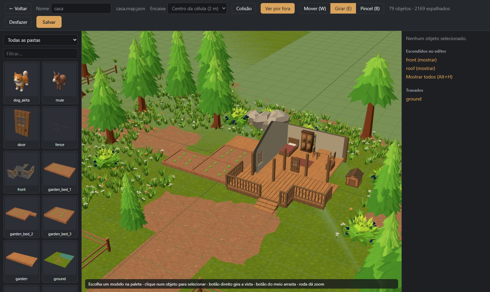 | 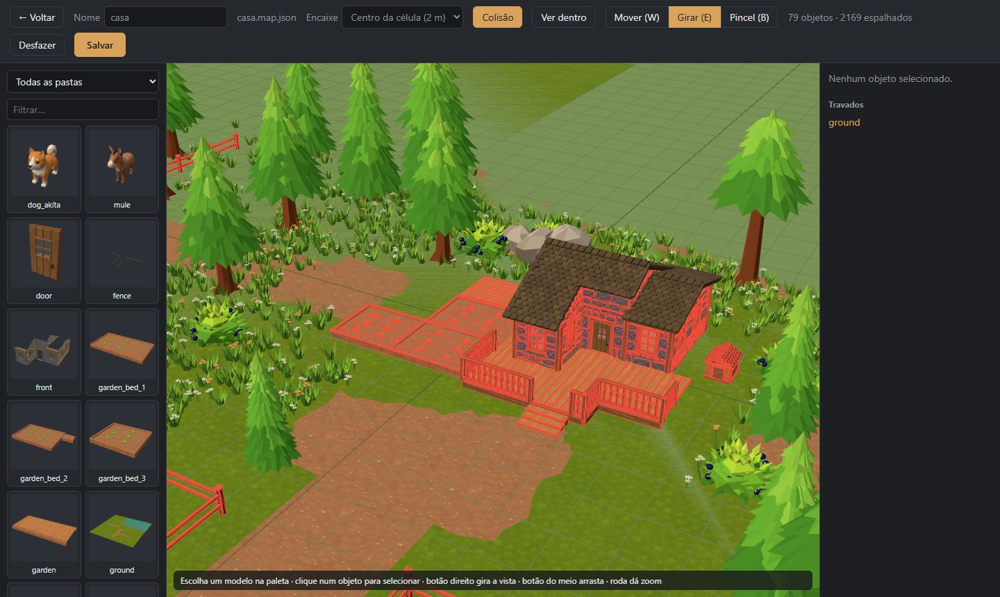 |
| Esconde o telhado e as paredes da frente, como o jogo faz quando a personagem entra. | Pinta de vermelho as malhas que o jogo deixa sólidas (pelo prefixo do nome). |

### Pincel

Com o **Pincel (B)** você escolhe o que espalhar e arrasta no chão. Raio, densidade e tamanho mínimo e máximo ficam no
painel, junto com a lista de camadas e quantas cópias cada uma tem. **Shift + arrastar** apaga.

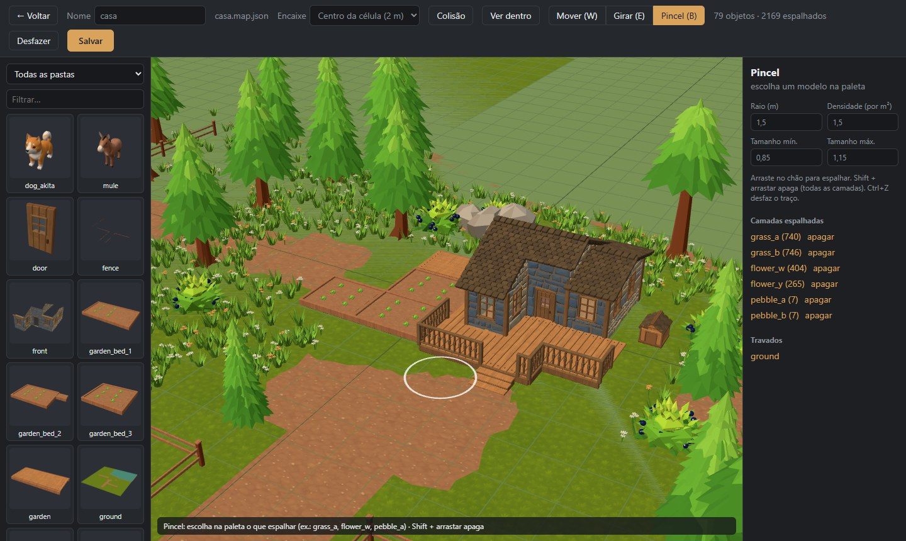

| Outro mapa | Configuração |
| --- | --- |
| 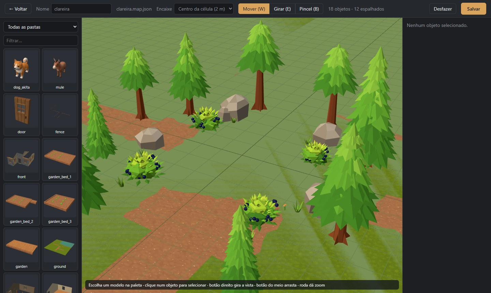 | 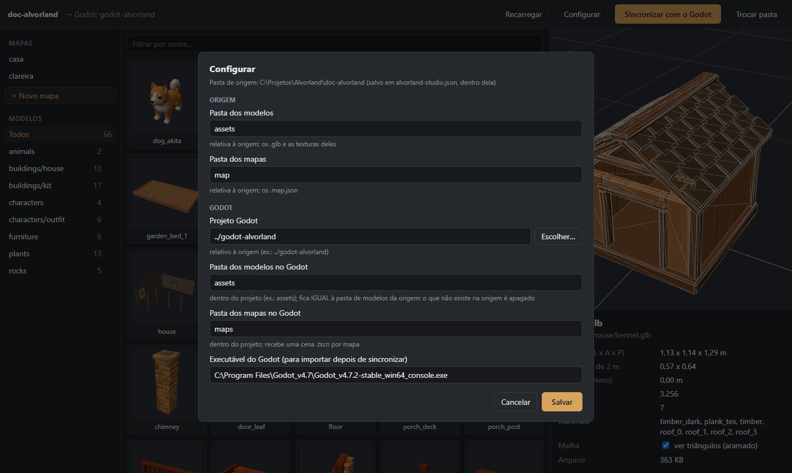 |

## Como funciona

**A origem manda.** Tudo nasce numa pasta de origem, que pode ficar versionada à parte do projeto Godot:

```
minha-origem/
  assets/                 modelos .glb (e as texturas deles), em subpastas (kit, nature, chars...)
  map/                    mapas da ferramenta (*.map.json)
  alvorland-studio.json   configuração (criada na primeira vez)
```

O botão **Sincronizar com o Godot** faz o resto:

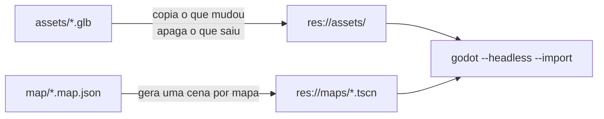

- `assets/` da origem vira a pasta de modelos do Godot (padrão `res://assets/`). Arquivos novos ou alterados são
  copiados e **o que não existe mais na origem é apagado**, menos os arquivos que o próprio Godot cria ao importar
  (`.import` e texturas extraídas). Por isso essa pasta pertence à ferramenta: não coloque nada à mão nela.
- Cada `map/<nome>.map.json` vira `res://maps/<nome>.tscn`, com um nó por objeto instanciando o `.glb`. As camadas
  do pincel viram `MultiMesh`, desenhadas por um `scatter.gd` que a sincronização grava junto.
- Antes de qualquer mudança aparece uma prévia; nada é alterado sem confirmação.
- A pasta de destino precisa ficar dentro do projeto Godot e não pode ser a raiz dele.

A configuração fica dentro da própria origem (`alvorland-studio.json`) com caminhos relativos, então vale em qualquer
computador que abrir a mesma pasta.

## Como rodar

Requisitos: **Node 20+** e **Rust** (cargo), além das
[dependências do Tauri](https://tauri.app/start/prerequisites/) para o seu sistema.

```bash
npm install
npm run tauri dev      # abre a janela em modo desenvolvimento
npm run tauri build    # gera o executável em src-tauri/target/release/
```

No Windows, `studio.bat` faz o mesmo que o `tauri dev` com dois cliques.

## Atalhos do editor de mapa

| Tecla | O que faz |
| --- | --- |
| **W** / **E** / **B** | Mover, Girar, Pincel |
| **R** / **Shift+R** | Gira 90° para um lado ou para o outro |
| **Q** / **T** | Gira 15° (com Shift, 1°) |
| **Page Up** / **Page Down** | Sobe e desce 10 cm (com Shift, 1 cm) |
| **H** / **Alt+H** | Esconde a peça selecionada / mostra todas (só no editor) |
| **Delete** / **Ctrl+D** | Apaga / duplica |
| **Ctrl+Z** / **Ctrl+S** | Desfaz / salva em `map/<nome>.map.json` |
| **Esc** | Para de colocar peças, solta a seleção e sai do pincel |
| Botão direito, botão do meio, roda | Gira a vista, arrasta, zoom |

O encaixe pode ser no centro da célula de 2 m, a cada meio metro ou livre. Ao arrastar com encaixe, a peça anda em
passos a partir de onde estava, sem ser puxada para o centro da célula. Objetos **travados** (como o chão do mapa)
não são selecionados clicando na vista e aparecem numa lista à direita para destravar.

Na tela de modelos, passe o mouse numa pasta e clique ↓ para marcá-la como "não são peças" (por exemplo, cenas
inteiras feitas no Blender): ela sai de "Todos" e da paleta do mapa. ↑ desfaz.

## Estrutura do código

| Caminho | Conteúdo |
| --- | --- |
| `src-tauri/src/lib.rs` | Lado Rust: ler `project.godot`, listar modelos e mapas, ler e gravar texto, miniaturas |
| `src-tauri/src/sync.rs` | Sincronização com o Godot (com testes: `cargo test` em `src-tauri`) |
| `src/workspace.ts` | Pasta de origem e configuração (`alvorland-studio.json`) |
| `src/App.tsx` | Tela inicial e tela da origem; `SyncDialog.tsx` e `ConfigDialog.tsx` são as janelas |
| `src/Viewer.tsx`, `src/Card.tsx` | Visualizador 3D e cartão com miniatura |
| `src/three/` | Carregar GLB (com texturas externas), gerar miniaturas, cache de modelos |
| `src/map/` | Editor de mapa (`MapEditor.tsx`), cena 3D (`mapScene.ts`), formato e exportação `.tscn` (`mapFile.ts`) |

## Autor

Feito por [Sidney Filho](https://github.com/sidneyfilho) para o jogo Alvorland.

## Bloqueios, áreas e regiões

No editor de mapa, o botão **Regras** abre o catálogo de colisão, as áreas e as regiões do mapa, nos mesmos arquivos
JSON que o jogo lê (com schema em `schemas/` da origem). Abas: **Colisão** (perfil de cada modelo e override por
instância, formas desenhadas pelo catálogo, caixas que o servidor usa), **Áreas** (zona segura, construção bloqueada ou
permitida, fazenda etc., por tags e prioridade), **Regiões** (área jogável e propriedades) e **Validação** (erros e
avisos com o caminho do campo; erros impedem salvar). O botão **Bloqueios** mostra o que o jogo bloqueia hoje, por tipo.
A sincronização também copia `<mapa>.areas.json`, `<mapa>.regions.json` e `<mapa>.adjust.json` e regrava
`<mapa>.blocks.json` e `server_shapes.json`. Para validar os dados sem abrir o app: `npm run validate:data`.
